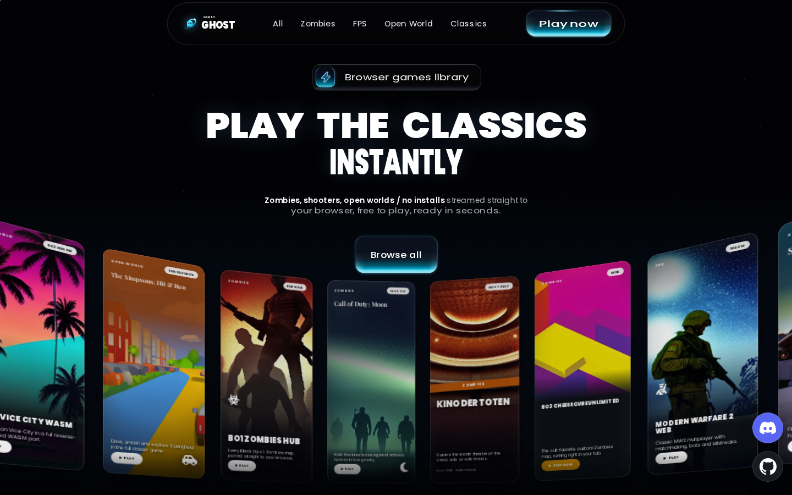
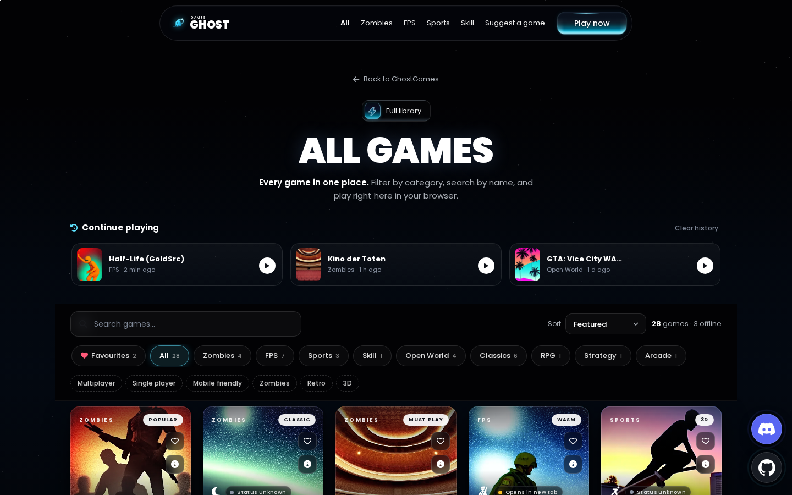
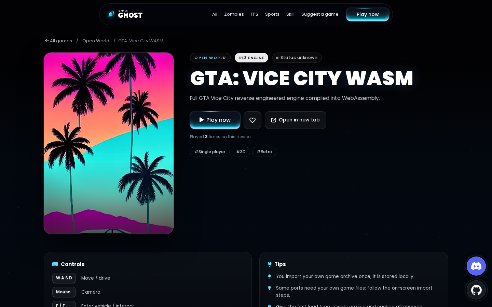
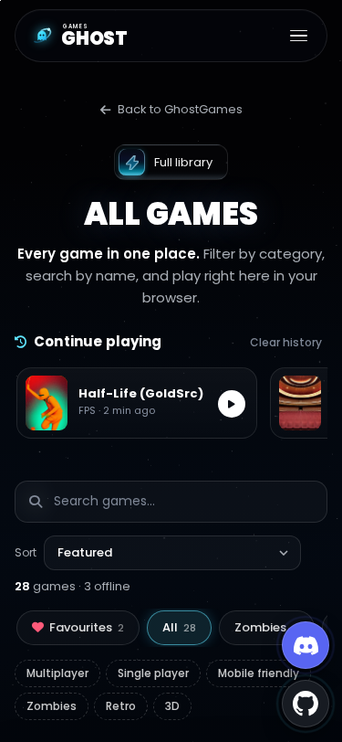

# 👻 GhostGames: Browser Games Library

Play classic and WebAssembly game ports right in your browser. There are no downloads, no installs and no account. Pick a game from the spinning 3D library, hit **Play**, and it opens in the built-in player.

## ▶️ [Play now: ghostgames.app](https://ghostgames.app)

Alternate (GitHub Pages): **[ghostfacemodz.github.io/GhostGames/new/](https://ghostfacemodz.github.io/GhostGames/new/)** · Classic version: [ghostfacemodz.github.io/GhostGames/](https://ghostfacemodz.github.io/GhostGames/)

## ✨ Features
- **3D spinning game library** with an original cover for every game
- **In-page player** with fullscreen, open in a new tab, and a fallback for games that block embedding
- **Browse all games** with category tabs, search, sorting (Featured, A–Z, Newest, Category) and tag filters (Multiplayer, Mobile friendly, Retro and more)
- **Continue playing and favourites**, saved on your device
- **A page for every game** with controls, tips, tags and similar games
- **Status dots**: 🟢 Online, 🟠 Issues (up but having problems), 🔴 Down
- **Hover previews** on desktop
- **Community**: a [Discord](https://discord.gg/zenclipsdaily-arc-raiders-store-bloodstrike-1408818003591827539) button and a Suggest-a-game form
- Works on desktop, tablet and phone

## 📸 Screenshots
| Library | Game page |
|---|---|
|  |  |

## 🎮 Games (45 playable, 51 listed)

### Zombies
| Game | About | How it runs | Status |
|---|---|---|---|
| [BO1 Zombies Hub](https://ghostgames.app/ghostgames/game/?id=bo1-zombies) | Every Black Ops 1 Zombies map, ported straight to your browser. | In player | 🟢 Online |
| [Call of Duty: Moon](https://ghostgames.app/ghostgames/game/?id=moon-zombies) | Hold the lunar base against endless hordes in low gravity. | In player | 🔴 Down |
| [Kino der Toten](https://ghostgames.app/ghostgames/game/?id=kino-der-toten) | Survive the iconic theater of the dead, solo or with friends. | In player | 🔴 Down |
| [BO3 Cheese Cube Unlimited](https://ghostgames.app/ghostgames/game/?id=bo3-cheese-cube) | The cult-favorite custom Zombies map, running right in your tab. | In player | 🔴 Down |
| [Super Mario Zombies](https://ghostgames.app/ghostgames/game/?id=super-mario-zombies) | Mario takes on ten classic Black Ops Zombies maps, right in your tab. | In player | 🟢 Online |

### FPS
| Game | About | How it runs | Status |
|---|---|---|---|
| [Black Ops 2 Web](https://ghostgames.app/ghostgames/game/?id=black-ops-2) | Black Ops 2 style multiplayer rebuilt for the browser. | New tab | 🔴 Down |
| [Modern Warfare 2 Web](https://ghostgames.app/ghostgames/game/?id=modern-warfare-2) | Classic MW2 multiplayer with matchmaking, bots and killstreaks. | New tab | 🟢 Online |
| [Halo: Combat Evolved](https://ghostgames.app/ghostgames/game/?id=halo-ce) | Master Chief returns: the original Halo campaign in your browser. | In player | 🟢 Online |
| [Halo CE Web Mobile](https://ghostgames.app/ghostgames/game/?id=halo-ce-mobile) 📱 | Halo: Combat Evolved tuned for touch controls on your phone. | In player | 🟢 Online |
| [Half-Life (GoldSrc)](https://ghostgames.app/ghostgames/game/?id=half-life) | Relive the Black Mesa incident on a web-built GoldSrc engine. | In player | 🟢 Online |
| [CS 1.6 / Xash3D](https://ghostgames.app/ghostgames/game/?id=web-xash-cs) | Counter-Strike 1.6 and Half-Life mods, running on WebXash. | In player | 🟢 Online |
| [Krunker.io](https://ghostgames.app/ghostgames/game/?id=krunker) 🎮 📱 | Fast voxel multiplayer FPS: jump in, aim, and frag instantly. | In player | 🟢 Online |

### Sports
| Game | About | How it runs | Status |
|---|---|---|---|
| [Skate 3 Browser](https://ghostgames.app/ghostgames/game/?id=skate-3) | Flip, grind and bail your way through a fan-made Skate 3. | In player | 🟢 Online |
| [Pro Evolution Soccer 6](https://ghostgames.app/ghostgames/game/?id=pes-6) 🎮 | The legendary PES 6 football, recompiled to play in-browser. | In player | 🟢 Online |

### Skill
| Game | About | How it runs | Status |
|---|---|---|---|
| [CS Surf Browser](https://ghostgames.app/ghostgames/game/?id=cs-surf) | Glide down impossible ramps with pure Counter-Strike surf movement. | In player | 🟢 Online |

### Open World
| Game | About | How it runs | Status |
|---|---|---|---|
| [GTA 5 Web Concept](https://ghostgames.app/ghostgames/game/?id=gta-5) | An archived Grand Theft Auto V web sandbox concept. | In player | 🔴 Down |
| [GTA: Vice City WASM](https://ghostgames.app/ghostgames/game/?id=gta-vice-city) | Cruise neon Vice City in a full reverse-engineered WASM port. | In player | 🟢 Online |
| [The Simpsons: Hit & Run](https://ghostgames.app/ghostgames/game/?id=simpsons-hit-and-run) | Drive, smash and explore Springfield in the full classic game. | In player | 🟢 Online |
| [Tweetcraft](https://ghostgames.app/ghostgames/game/?id=tweetcraft) 📱 | A shared Minecraft-style voxel world anyone can join and build in. | New tab | 🟢 Online |
| [GTA V (browser port)](https://ghostgames.app/ghostgames/game/?id=gta-v-web) | GTA V in your browser. Weak PC? Low-graphics mode. Free roam? Sandbox mode. | Own page | 🟢 Online |
| [GTA III Web](https://ghostgames.app/ghostgames/game/?id=gta-3) | Cruise Liberty City in the classic 2001 open-world game, right in your browser. | New tab | 🟢 Online |

### Classic Shooter
| Game | About | How it runs | Status |
|---|---|---|---|
| [Quake 1 WASM](https://ghostgames.app/ghostgames/game/?id=quake-1) | id Software's 1996 shooter, fast and brutal in your browser. | In player | 🟢 Online |
| [Quake II WASM](https://ghostgames.app/ghostgames/game/?id=quake-2) | Battle the Strogg online in real Quake II multiplayer. | In player | 🟢 Online |
| [Quake III Arena](https://ghostgames.app/ghostgames/game/?id=quake-3) 🎮 | Rocket jumps and railguns: pure arena frag fest, no install. | In player | 🟢 Online |
| [Return to Castle Wolfenstein](https://ghostgames.app/ghostgames/game/?id=rtcw) | Storm occult Nazi strongholds in classic WW2 team multiplayer. | In player | 🟢 Online |
| [Unreal Tournament](https://ghostgames.app/ghostgames/game/?id=unreal-tournament) | Facing Worlds, the Redeemer and UT99 frags with online multiplayer. | New tab | 🟢 Online |
| [Silent Space Marine (Doom WASM)](https://ghostgames.app/ghostgames/game/?id=silent-space-marine) | Cloudflare's WebAssembly Doom port with solo and online play. | In player | 🟢 Online |

### RPG
| Game | About | How it runs | Status |
|---|---|---|---|
| [Diablo I Web](https://ghostgames.app/ghostgames/game/?id=diablo-1) | Descend the cursed labyrinth beneath Tristram in original Diablo. | In player | 🟢 Online |

### Strategy
| Game | About | How it runs | Status |
|---|---|---|---|
| [Hedgewars (WASM)](https://ghostgames.app/ghostgames/game/?id=hedgewars) | Worms-style artillery chaos with hedgehogs and absurd weapons. | In player | 🔴 Down |

### Arcade
| Game | About | How it runs | Status |
|---|---|---|---|
| [WASM Arcade](https://ghostgames.app/ghostgames/game/?id=wasm-arcade) | A huge hub of PC and arcade classics compiled for browsers. | New tab | 🟢 Online |

### Retro
| Game | About | How it runs | Status |
|---|---|---|---|
| [Tobu Tobu Girl](https://ghostgames.app/ghostgames/game/?id=tobu-tobu-girl) 🎮 📱 | An open-source Game Boy arcade platformer about flying higher and higher. | In player | 🟢 Online |
| [µCity](https://ghostgames.app/ghostgames/game/?id=ucity) 🎮 📱 | A full city-builder sim, open source, on the Game Boy Color. | In player | 🟢 Online |
| [Nova the Squirrel](https://ghostgames.app/ghostgames/game/?id=nova-the-squirrel) 🎮 📱 | A modern NES homebrew platformer with copyable enemy powers. | In player | 🟢 Online |
| [Retro Player (bring your own ROM)](https://ghostgames.app/ghostgames/game/?id=retro-player) 🎮 📱 | Load your own ROM from your device and play in the browser. Nothing is uploaded. | In player | 🟢 Online |
| [The Legend of Zelda: Ocarina of Time](https://ghostgames.app/ghostgames/game/?id=zelda-oot-embed) 🎮 📱 | Link's legendary N64 adventure through Hyrule and time. | In player | 🟢 Online |
| [Sonic the Hedgehog](https://ghostgames.app/ghostgames/game/?id=sonic-1-embed) 🎮 | Sega's original high-speed platformer. | In player | 🟢 Online |
| [Sonic the Hedgehog 2](https://ghostgames.app/ghostgames/game/?id=sonic-2-embed) 🎮 | Sonic and Tails' faster, bigger sequel. | In player | 🟢 Online |
| [Super Mario Advance](https://ghostgames.app/ghostgames/game/?id=super-mario-advance-embed) 🎮 📱 | The GBA take on Super Mario Bros. 2. | In player | 🟢 Online |
| [Metroid II: Return of Samus](https://ghostgames.app/ghostgames/game/?id=metroid-2-embed) 🎮 📱 | Samus hunts the last Metroids on SR388. | In player | 🟢 Online |
| [Pokémon Emerald](https://ghostgames.app/ghostgames/game/?id=pokemon-emerald-embed) 🎮 | Catch and battle your way across Hoenn. | In player | 🟢 Online |
| [Super Mario Bros.](https://ghostgames.app/ghostgames/game/?id=super-mario-bros-embed) 🎮 | The NES platformer that started it all. | In player | 🟢 Online |
| [Contra](https://ghostgames.app/ghostgames/game/?id=contra-embed) 🎮 | Konami's legendary NES run-and-gun. | In player | 🟢 Online |
| [Metal Slug](https://ghostgames.app/ghostgames/game/?id=metal-slug-embed) 🎮 | SNK's hand-drawn arcade run-and-gun. | In player | 🟢 Online |
| [The King of Fighters '98](https://ghostgames.app/ghostgames/game/?id=kof98-embed) 🎮 | SNK's classic 3-on-3 team fighter. | In player | 🟢 Online |
| [Sonic the Hedgehog 3](https://ghostgames.app/ghostgames/game/?id=sonic-3-embed) 🎮 | Sonic and Tails versus Knuckles on Angel Island. | In player | 🟢 Online |
| [Kirby & The Amazing Mirror](https://ghostgames.app/ghostgames/game/?id=kirby-amazing-mirror-embed) 🎮 | Kirby's open-ended Mirror World adventure. | In player | 🟢 Online |
| [Castlevania: Symphony of the Night](https://ghostgames.app/ghostgames/game/?id=castlevania-sotn-embed) 🎮 | Alucard's genre-defining castle crawl. | In player | 🟢 Online |
| [Harvest Moon: Friends of Mineral Town](https://ghostgames.app/ghostgames/game/?id=harvest-moon-mfomt-embed) 🎮 | Cozy GBA farm life in Mineral Town. | In player | 🟢 Online |

### Co-op
| Game | About | How it runs | Status |
|---|---|---|---|
| [PEAK (web port)](https://ghostgames.app/ghostgames/game/?id=peak) | Climb a deadly island mountain, solo or with friends. | In player | 🟢 Online |
| [How to Fish](https://ghostgames.app/ghostgames/game/?id=how-to-fish) | Take the boat out and reel in fish, alone or with friends. | In player | 🟢 Online |
| [Among Us Web](https://ghostgames.app/ghostgames/game/?id=among-us) 📱 | Complete tasks or sabotage as the impostor — Among Us in your browser. | In player | 🟢 Online |

🎮 = controller supported · 📱 = plays on mobile

## 💬 Community
Join the [Discord](https://discord.gg/zenclipsdaily-arc-raiders-store-bloodstrike-1408818003591827539), or use **Suggest a game** on the site to request new titles.

---
All game trademarks belong to their respective owners. GhostGames links to and embeds fan-made browser ports hosted by third parties.
